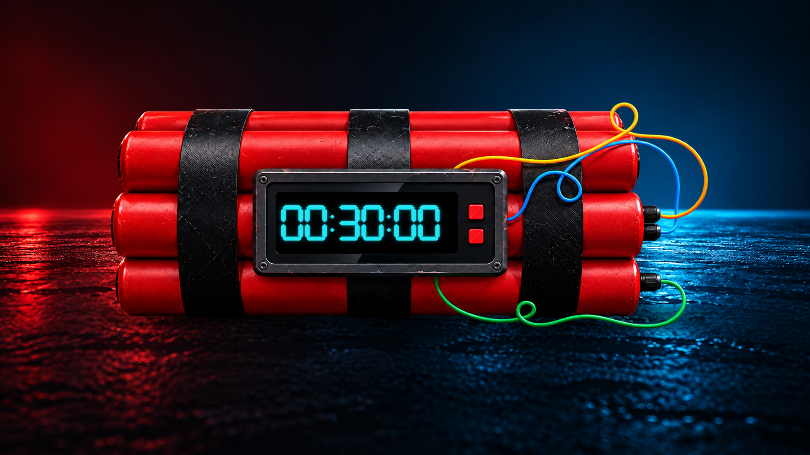

# FuseTime — Shutdown Timer for Windows

**Schedule automatic shutdown, restart, sleep or lock with a live digital countdown.**

FuseTime is a Windows shutdown timer by **Idylle Soft**. Set a countdown of up to 24 hours, choose what your PC should do when time runs out, and keep track of the remaining time on an animated digital display. Optional cable-combination protection adds an interactive way to cancel a running timer.

**[Download FuseTime from Microsoft Store](https://apps.microsoft.com/detail/9NBWX45L2ZC0)** · [Türkçe](README.tr.md) · [Privacy Policy](https://idyllesoft.github.io/IdylleSoft-Privacy/fusetime-privacy-policy.html)



*Promotional artwork. For current application screenshots, availability and release details, visit the Microsoft Store listing.*

## At a glance

| | FuseTime |
|---|---|
| Purpose | Automatic PC shutdown timer and countdown for Windows |
| Actions | Shut down, restart, sleep, lock |
| Countdown | Hours and minutes, up to 24 hours |
| Languages | English, Turkish, German |
| Platform | Windows 10 / Windows 11, x64 |
| Installation | Microsoft Store |
| Publisher | Idylle Soft |
| Account | No FuseTime account required |

## Download and install

1. Open **[FuseTime — Shutdown Timer in Microsoft Store](https://apps.microsoft.com/detail/9NBWX45L2ZC0)**.
2. Select the available install/get option and follow the Store instructions.
3. Launch FuseTime from the Windows Start menu.

Use the Store listing for current pricing, regional availability and the version available to your device. You do not need Python or a development environment to use the packaged app.

## What can you do with FuseTime?

- **Schedule a Windows shutdown:** turn off your PC after a chosen delay.
- **Set a restart timer:** restart Windows when your countdown finishes.
- **Schedule sleep mode:** put your computer to sleep after a set duration.
- **Set a workstation lock timer:** lock your Windows session without shutting down.
- **Leave a timer running in the system tray:** keep the main window out of the way while the countdown continues.
- **Explore the interface safely:** use Test Mode before trying cable protection or a real system action.

For example, if you expect a download or a long task to take another hour, you can set a one-hour shutdown timer. FuseTime's countdown does **not** detect whether that task has actually finished; choose sufficient time yourself.

## Main features

### Four actions, one timer

Choose **Shut down**, **Restart**, **Sleep** or **Lock**. Set the delay with the hour and minute arrows, then start the countdown. Hold an arrow to adjust the value faster. A zero-duration timer cannot be started.

### Live digital display

Follow the remaining time on a glowing digital clock. The animated scene includes atmospheric lighting, fog, particles and colored cables, with a compact glass-style control panel below.

### Optional cable-combination protection

Save an ordered sequence of one to four different cable colors. During a protected countdown, cancel the timer by cutting the selected cables in the correct order.

- With all cable positions set to **Not used**, protection is off and the running timer has a normal **Cancel** button.
- With protection enabled, the running button shows **Protected**.
- Cables are interactive only while a protected timer is running.
- Protection settings cannot be changed during an active timer.

> **Important:** cutting a wrong cable or using the wrong order rapidly accelerates the countdown to zero. Further cable cuts cannot cancel that accelerated countdown. The selected Windows action will then run without an additional confirmation. Try this feature in **Test Mode** first.

Cable protection is an interface feature, not a security boundary. It does not prevent termination by Windows Task Manager, administrators or other system tools.

### System tray support

Send FuseTime to the tray using the title-bar button. Hover over its tray icon to see the **selected action and remaining time**. A single left-click restores the window.

Minimizing or sending the app to the tray keeps the timer running. Normal close requests are blocked while a protected countdown is active; use the correct combination to cancel it. Closing an unprotected countdown cancels it.

### Customizable sound and warning settings

Adjust the master volume and separately enable or disable interface sounds and countdown sounds. When **Warning before execution** is enabled, the final 30-second warning can play countdown audio and bring FuseTime to the foreground. The digital display and indicator lights provide visual countdown feedback.

### Safe Test Mode

Enable **Test Mode** in **Settings → Options** to try the countdown, cable combinations, sound effects and warning states without performing a real shutdown, restart, sleep or lock action.

Test Mode cannot be changed while a timer is running. It is session-only: a normal application restart returns FuseTime to real-action mode. Check the visible Test Mode indicator before experimenting.

### Remembers your settings

FuseTime remembers your last duration, language, cable combination, sound preferences and other saved options. The interface supports **English, Turkish and German**. On first use, a supported Windows UI language is selected automatically; other system languages fall back to English.

## Quick start

1. Open FuseTime.
2. Use the **Hours** and **Minutes** arrows to choose a duration.
3. Select **Shut down**, **Restart**, **Sleep** or **Lock**.
4. Save your work before scheduling a real action.
5. Click **Start Timer**.
6. Keep the window open or send it to the tray.

For a first try, enable **Settings → Options → Test Mode** and leave protection off. Once familiar with the controls, try a cable combination in Test Mode before using it with real system actions.

## Important behavior and limitations

- **Forced shutdown/restart is enabled by default.** You can disable it in Settings. Force mode applies to shutdown and restart, not sleep or lock.
- Forced shutdown or restart may close programs with unsaved work. Save your work before starting.
- At zero, FuseTime waits approximately **two seconds** before executing the selected action. This is not an extra confirmation prompt.
- FuseTime must remain running for the timer to execute. It does not turn on a powered-off PC or provide a wake-from-sleep scheduling feature.
- This is a countdown timer, not a recurring weekly scheduler or a download-completion detector.
- Actual execution can depend on Windows permissions, power settings and system state.

## System requirements

| Component | Requirement |
|---|---|
| Operating system | Windows 10 version 2004 / build 19041 or later, or Windows 11 |
| Architecture | x64 for the current package |
| Interface runtime | Microsoft Edge WebView2 Runtime |
| Input | Mouse or another suitable pointing device recommended |

The Microsoft Store listing is the reference for device eligibility and current package requirements. If the app cannot start because WebView2 is missing, install the [Microsoft Edge WebView2 Evergreen Runtime](https://developer.microsoft.com/en-us/microsoft-edge/webview2/).

## Privacy and data handling

FuseTime does not require a user account. Preferences and diagnostic logs are stored locally, normally under:

```text
%LOCALAPPDATA%\IdylleSoft\FuseTime — Shutdown Timer
```

**The application also sends automatic launch reports.** These include a random installation ID, app and Windows versions, the current application language, the initially detected system language and an event identifier. Cloudflare estimates the country from the connection. Reports are stored in Cloudflare D1 and summarized in Telegram notifications to Idylle Soft. There is no in-app switch to disable launch reporting.

The raw IP address is not saved in the application's database, but service providers process connection information. The installation ID is protected with Windows DPAPI and retained in multiple local locations. It and the initial language record survive the app's settings reset. Diagnostic logs are not automatically uploaded.

The Discover feature also checks a remote visibility setting. Opening support creates an editable email draft with technical details; it does not send an email automatically.

Read the **[full Privacy Policy](https://idyllesoft.github.io/IdylleSoft-Privacy/fusetime-privacy-policy.html)** for recipients, storage, retention and deletion requests. Do not assume the application is fully offline or that its data is entirely confined to your PC.

## Frequently asked questions

### How do I automatically shut down my PC after one hour?

Set **Hours** to `01` and **Minutes** to `00`, choose **Shut down**, and click **Start Timer**. Save your work first and confirm that Test Mode is off if you want a real shutdown.

### Can I cancel the shutdown timer?

Yes. With protection off, click **Cancel**. With protection on, cut the correct cables in the saved order. After a wrong cut triggers acceleration, further cuts cannot cancel it.

### Does the countdown continue in the tray?

Yes. Hover over the tray icon to check the remaining time, or click it once to reopen FuseTime.

### Why does the countdown speed up after a cable cut?

That is the wrong-combination behavior. A wrong cable or incorrect order accelerates the timer and leads to the selected action. Use Test Mode to learn the feature safely.

### Can I try the app without shutting down Windows?

Yes. Enable Test Mode before starting. The timer and effects work, but real system actions are simulated.

### Does FuseTime schedule recurring tasks or wait for downloads to finish?

No. FuseTime schedules an action after a chosen countdown. It does not inspect download progress or offer recurring weekly rules.

### Will resetting settings remove my installation identity?

No. **Reset everything** restores saved preferences but does not remove the persistent reporting identity, initial language record or reporting queue.

## Support and feedback

- **Email:** [idyllesoft@outlook.com](mailto:idyllesoft@outlook.com)
- **In the app:** Settings → About → Contact Me
- **Other Idylle Soft apps:** [Microsoft Store publisher page](https://apps.microsoft.com/search/publisher?name=Idylle+Soft)

When reporting a problem, include your app version, Windows version, reproduction steps and any error message. Remove unnecessary personal information from screenshots and logs before sharing them.

If FuseTime is useful to you, you can leave an honest review using the app's **Rate in Microsoft Store** button.

---

**Ready to set your next PC countdown? [Get FuseTime — Shutdown Timer from Microsoft Store.](https://apps.microsoft.com/detail/9NBWX45L2ZC0)**
