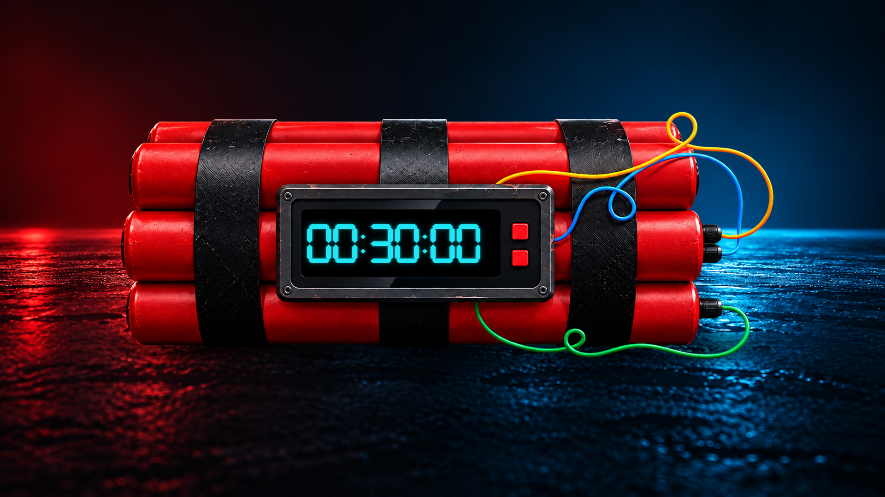

# FuseTime — Windows İçin Otomatik Kapatma Zamanlayıcısı

**Bilgisayarı kapatma, yeniden başlatma, uykuya alma ve kilitleme işlemlerini canlı dijital sayaçla zamanlayın.**

**FuseTime — Shutdown Timer**, Idylle Soft tarafından geliştirilen bir Windows kapatma zamanlayıcısıdır. 24 saate kadar bir süre belirleyin, sayaç bittiğinde gerçekleşecek işlemi seçin ve kalan süreyi dijital ekrandan takip edin. İsteğe bağlı kablo kombinasyonu korumasıyla çalışan sayacı farklı bir yöntemle iptal edebilirsiniz.

**[Microsoft Store’dan indir](https://apps.microsoft.com/detail/9NBWX45L2ZC0)** · [English](README.md) · [Gizlilik Politikası](https://idyllesoft.github.io/IdylleSoft-Privacy/fusetime-privacy-policy.html#turkce)



*Tanıtım görselidir. Güncel uygulama ekran görüntüleri, kullanılabilirlik ve sürüm bilgileri için Microsoft Store sayfasına bakın.*

## Bir bakışta FuseTime

| Özellik | Açıklama |
|---|---|
| Amaç | Windows için otomatik kapatma ve işlem zamanlayıcısı |
| İşlemler | Kapatma, yeniden başlatma, uyku, kilitleme |
| Süre | Saat ve dakika seçimiyle 24 saate kadar |
| Diller | Türkçe, İngilizce ve Almanca |
| Platform | Windows 10 / Windows 11, x64 |
| Kurulum | Microsoft Store |
| Geliştirici | Idylle Soft |
| Hesap | FuseTime hesabı gerektirmez |

## İndirme ve kurulum

1. **[FuseTime — Shutdown Timer mağaza sayfasını](https://apps.microsoft.com/detail/9NBWX45L2ZC0)** açın.
2. Mağazada sunulan edinme/yükleme seçeneğini kullanarak kurulumu tamamlayın.
3. Uygulamayı Windows Başlat menüsünden açın.

Güncel fiyat, bölgesel kullanılabilirlik ve cihazınıza sunulan sürüm Microsoft Store’da gösterilir. Paketli uygulamayı kullanmak için Python veya geliştirme ortamı kurmanız gerekmez.

## FuseTime ile neler yapabilirsiniz?

- Belirlediğiniz süre sonunda **bilgisayarı otomatik kapatabilirsiniz**.
- Windows için **yeniden başlatma zamanlayıcısı** oluşturabilirsiniz.
- Bilgisayarınızı süre sonunda **uykuya alabilirsiniz**.
- Windows oturumunuzu kapatmadan **ekranı kilitleyebilirsiniz**.
- Sayacı **sistem tepsisinde** çalıştırıp kalan süreyi simgeden görebilirsiniz.
- **Test moduyla** gerçek sistem işlemlerini uygulamadan arayüzü deneyebilirsiniz.

Örneğin bir indirme veya uzun işlemin yaklaşık bir saat sonra biteceğini düşünüyorsanız bir saatlik kapatma sayacı kurabilirsiniz. FuseTime işlemin gerçekten tamamlanıp tamamlanmadığını algılamaz; yeterli süreyi sizin belirlemeniz gerekir.

## Öne çıkan özellikler

### Dört farklı zamanlanmış işlem

**Kapat**, **Yeniden başlat**, **Uyku** veya **Kilitle** seçeneklerinden birini belirleyin. Saat ve dakika oklarıyla süreyi ayarlayın; okları basılı tutarak daha hızlı değiştirin. Sıfır süreli sayaç başlatılamaz.

### Canlı dijital geri sayım

Kalan süreyi parlak dijital ekrandan takip edin. Hareketli arka plan, atmosferik ışıklar, sis, parçacıklar ve renkli kablolar görsel deneyimi tamamlar. Kontroller alt bölümdeki cam görünümlü panelde bulunur.

### İsteğe bağlı kablo kombinasyonu koruması

Bir ila dört farklı renk için kesme sırası belirleyebilirsiniz. Korumalı sayaç çalışırken doğru kabloları kayıtlı sırayla kesmek sayacı iptal eder.

- Bütün alanlar **Kullanılmıyor** olarak bırakılırsa koruma kapalıdır; çalışan sayaç **İptal** düğmesiyle durdurulur.
- Koruma açıksa çalışan işlem düğmesi **Korumalı** durumuna geçer.
- Kablolar yalnızca korumalı işlem çalışırken kesilebilir.
- Aktif sayaç sırasında koruma ayarları değiştirilemez.

> **Önemli:** Yanlış kablo veya yanlış sıra, sayacı hızla sıfıra indirir. Bundan sonra kablo keserek iptal edilemez. Seçili Windows işlemi ek onay alınmadan uygulanır. Bu özelliği önce **Test Modu** ile deneyin.

Kablo koruması bir arayüz özelliğidir; Windows güvenlik mekanizması değildir. Görev Yöneticisi, yönetici veya diğer sistem araçlarıyla sonlandırmayı engellemez.

### Sistem tepsisinde çalışma

Üst çubuktaki tepsi simgesiyle pencereyi gizleyebilirsiniz. Tepsi simgesinin üzerine gelince **kalan süre ve seçili işlem** görünür. Tek sol tıklama pencereyi geri getirir.

Simge durumuna küçültmek veya tepsiye göndermek sayacı durdurmaz. Korumalı sayaç sırasında normal kapatma girişimleri engellenir; doğru kombinasyonla iptal edebilirsiniz. Korumasız sayaçta uygulamayı kapatmak işlemi iptal eder.

### Ayarlanabilir sesler ve uyarılar

Genel ses seviyesini değiştirebilir, arayüz ve geri sayım seslerini ayrı ayrı açıp kapatabilirsiniz. **İşlem öncesi uyarı** etkinse son 30 saniyede uyarı sesleri çalabilir ve FuseTime ön plana gelebilir. Dijital gösterge ve durum ışıkları görsel uyarı sağlar.

### Güvenli test modu

**Ayarlar → Seçenekler → Test Modunu Aç** ile sayaç, sesler, uyarılar ve kablo kombinasyonlarını gerçek kapatma, yeniden başlatma, uyku veya kilitleme uygulanmadan deneyebilirsiniz.

Test modu aktif sayaç sırasında değiştirilemez. Yalnızca mevcut oturum için geçerlidir; uygulama normal şekilde yeniden açıldığında gerçek işlem moduna döner. Denemeden önce görünür test modu göstergesini kontrol edin.

### Tercihlerinizi hatırlar

Son ayarlanan süre, arayüz dili, kablo kombinasyonu ve ses ayarları saklanır. **Türkçe, İngilizce ve Almanca** desteklenir. İlk açılışta Windows arayüz dili destekleniyorsa otomatik seçilir; diğer dillerde İngilizce kullanılır. Dil tercihini ayarlardan değiştirebilirsiniz.

## Hızlı başlangıç

1. FuseTime’ı açın.
2. **Saat** ve **Dakika** oklarıyla süreyi belirleyin.
3. Gerçekleşmesini istediğiniz işlemi seçin.
4. Gerçek işlem planlamadan önce çalışmalarınızı kaydedin.
5. **Başlat** düğmesine tıklayın.
6. Pencereyi açık bırakın veya uygulamayı sistem tepsisine gönderin.

İlk denemenizde test modunu açıp korumayı kapalı bırakmanız önerilir. Kontrolleri öğrendikten sonra kablo kombinasyonunu da test modunda deneyebilirsiniz.

## Önemli davranışlar ve sınırlar

- **Zorla kapatma/yeniden başlatma varsayılan açıktır.** Ayarlardan kapatabilirsiniz. Uyku ve kilitleme için geçerli değildir.
- Zorlama modu, kaydedilmemiş çalışmaların bulunduğu programları kapatabilir. Önce çalışmalarınızı kaydedin.
- Sayaç sıfırlandığında yaklaşık **iki saniye** beklenir ve işlem uygulanır. Bu süre ek onay penceresi değildir.
- Sayacın işlem uygulayabilmesi için FuseTime çalışır durumda kalmalıdır. Kapalı bilgisayarı açma veya uyuyan bilgisayarı zamanlayarak uyandırma özelliği yoktur.
- Uygulama süreye dayalı geri sayım kullanır; haftalık tekrarlanan görev veya indirme tamamlanmasını algılama özelliği sunmaz.
- İşlemin gerçekleşmesi Windows izinleri, güç ayarları ve sistem durumuna bağlı olabilir.

## Sistem gereksinimleri

| Bileşen | Gereksinim |
|---|---|
| İşletim sistemi | Windows 10 sürüm 2004 / derleme 19041 veya üzeri; Windows 11 |
| Mimari | Mevcut paket için x64 |
| Arayüz bileşeni | Microsoft Edge WebView2 Runtime |
| Giriş | Fare veya uygun bir işaretleme aygıtı önerilir |

Cihaz uygunluğu ve güncel gereksinimler için Microsoft Store sayfasını esas alın. WebView2 eksikse [Microsoft Edge WebView2 Evergreen Runtime](https://developer.microsoft.com/en-us/microsoft-edge/webview2/) yükleyebilirsiniz.

## Gizlilik ve veri kullanımı

FuseTime hesabı gerektirmez. Tercihler ve tanılama günlükleri normalde şu yerel klasörde tutulur:

```text
%LOCALAPPDATA%\IdylleSoft\FuseTime — Shutdown Timer
```

**Uygulama otomatik açılış bildirimleri de gönderir.** Rastgele kurulum kimliği, uygulama ve Windows sürümleri, güncel uygulama dili, ilk sistem dili ve olay kimliği bildirilir. Cloudflare bağlantıdan ülke tahmini yapar. Kayıtlar Cloudflare D1’de saklanır ve Idylle Soft’a Telegram bildirimleri iletilir. Uygulamada açılış bildirimini kapatma anahtarı bulunmaz.

Ham IP adresi uygulamanın veritabanına kaydedilmez; hizmet sağlayıcıları bağlantı bilgilerini işler. Kurulum kimliği Windows DPAPI ile korunarak birden fazla yerel konumda tutulur. Ayarları sıfırlamak bu kimliği ve ilk dil kaydını silmez. Tanılama günlükleri otomatik yüklenmez.

Keşfet özelliği uzaktan görünürlük ayarı sorgular. Destek düğmesi, teknik bilgileri içeren düzenlenebilir bir e-posta taslağı açar; otomatik e-posta göndermez.

Alıcılar, saklama ve silme talepleri için **[Gizlilik Politikası’nı okuyun](https://idyllesoft.github.io/IdylleSoft-Privacy/fusetime-privacy-policy.html#turkce)**. Uygulamanın tamamen çevrimdışı çalıştığı veya bütün verilerin yalnızca cihazda kaldığı varsayılmamalıdır.

## Sık sorulan sorular

### Bilgisayarı bir saat sonra nasıl kapatabilirim?

Saati `01`, dakikayı `00` yapın. **Kapat** işlemini seçip **Başlat** düğmesine tıklayın. Önce çalışmalarınızı kaydedin; gerçek kapatma istiyorsanız test modunun kapalı olduğunu kontrol edin.

### Geri sayımı nasıl iptal ederim?

Koruma kapalıysa **İptal** düğmesini kullanın. Açıksa doğru kabloları kaydedilen sırayla kesin. Yanlış kesimle hızlanmış sayaç, sonraki kablo kesimleriyle iptal edilemez.

### Tepsiye gönderince sayaç çalışmaya devam eder mi?

Evet. Kalan süre için tepsi simgesinin üzerine gelin; pencereyi açmak için bir kez sol tıklayın.

### Yanlış kabloyu kesince sayaç neden hızlanıyor?

Bu, kombinasyon korumasının davranışıdır. Yanlış kablo veya sıra, sayacı hızlandırarak seçili işleme götürür. Gerçek işlem uygulanmadan öğrenmek için test modunu kullanın.

### Gerçek işlem yapmadan deneyebilir miyim?

Evet. Sayaç başlatmadan önce test modunu açın. Görseller ve sesler çalışır, sistem işlemleri uygulanmaz.

### İndirme bitince otomatik kapatabilir mi?

FuseTime indirme ilerlemesini izlemez. Beklenen süreye göre bir geri sayım ayarlayabilirsiniz; görevin gerçekten bitmesi denetlenmez.

### Ayarları sıfırlamak kurulum kimliğini siler mi?

Hayır. Sıfırlama tercihleri varsayılana döndürür; kalıcı bildirim kimliği, ilk dil kaydı ve bildirim kuyruğu korunur.

## Destek ve geri bildirim

- **E-posta:** [idyllesoft@outlook.com](mailto:idyllesoft@outlook.com)
- **Uygulamada:** Ayarlar → Hakkında → Bana Ulaşın
- **Diğer uygulamalarımız:** [Idylle Soft Microsoft Store sayfası](https://apps.microsoft.com/search/publisher?name=Idylle+Soft)

Bir sorun bildirirken uygulama sürümünü, Windows sürümünü, tekrar oluşturma adımlarını ve hata mesajını ekleyin. Günlük veya ekran görüntüsü paylaşırken gereksiz kişisel bilgileri kaldırın.

FuseTime işinize yaradıysa uygulamadaki **Mağazada değerlendir** düğmesiyle dürüst bir değerlendirme bırakabilirsiniz.

---

**[FuseTime — Shutdown Timer’ı Microsoft Store’dan indirin.](https://apps.microsoft.com/detail/9NBWX45L2ZC0)**
